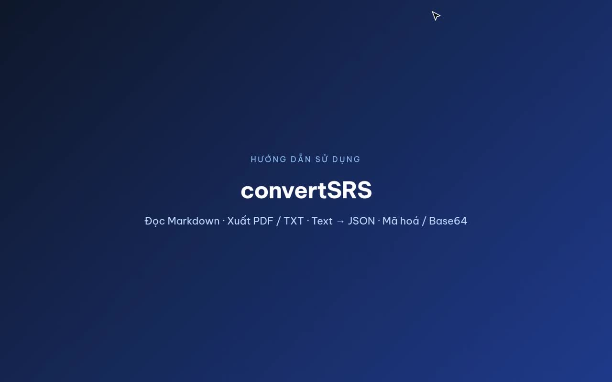

# convertSRS — Đọc Markdown, xuất PDF / TXT, sơ đồ Mermaid vector

> Công cụ web và ứng dụng Windows để **đọc tài liệu đặc tả yêu cầu phần mềm (SRS) viết bằng Markdown**, **chuyển Markdown sang PDF** có mục lục, trang bìa, đánh số trang và **sơ đồ Mermaid dạng vector**. Kèm bộ công cụ cho lập trình viên: **Text → JSON** (format JSON, chuyển log / Java `toString()` / CSV sang JSON), **SHA-256 / HMAC**, **Base64 encode / decode**, **giải mã JWT**, **sinh cặp khoá RSA / ECDSA / Ed25519**, **mã 2FA (TOTP)** và **sinh password ngẫu nhiên**. Mọi xử lý mã hoá chạy ngay trên trình duyệt, dữ liệu không rời khỏi máy.

[](#chạy-local)
[](#deploy-lên-vercel)
[-0078D6?logo=windows&logoColor=white)](#ứng-dụng-windows-desktop)
[](#sơ-đồ-mermaid)
[](#kiến-trúc--công-nghệ)

**Từ khoá:** Markdown to PDF · Markdown viewer · SRS document · Mermaid to PDF / SVG / PNG · flowchart to sequence diagram · JSON formatter · log to JSON · Java toString to JSON · CSV to JSON · SHA-256 online · HMAC · Base64 encoder / decoder · JWT decoder · RSA / ECDSA / Ed25519 key generator · PEM / JWK · TOTP 2FA · password generator · Vercel · Electron.

**🌐 Dùng thử ngay:** [readmd-flax.vercel.app](https://readmd-flax.vercel.app) · Mở thẳng [Text → JSON](https://readmd-flax.vercel.app/#json) · [Mã hoá / Base64](https://readmd-flax.vercel.app/#crypto)

## Video hướng dẫn

[](docs/huong-dan-convertSRS.mp4)

▶️ **[Xem video hướng dẫn (MP4, 3 phút 53 giây)](docs/huong-dan-convertSRS.mp4)**: đọc tài liệu SRS, sơ đồ Mermaid, xuất PDF; Text → JSON; SHA-256, Base64, JWT, sinh cặp khoá, mã 2FA và sinh password.

---

## Mục lục

- [Video hướng dẫn](#video-hướng-dẫn)
- [Vì sao dùng convertSRS](#vì-sao-dùng-convertsrs)
- [Tính năng](#tính-năng)
  - [Đọc tài liệu Markdown / SRS](#1-đọc-tài-liệu-markdown--srs)
  - [Xuất PDF và TXT](#2-xuất-pdf-và-txt)
  - [Sơ đồ Mermaid](#sơ-đồ-mermaid)
  - [Text → JSON](#3-text--json)
  - [Mã hoá / Base64](#4-mã-hoá--base64)
  - [Giao diện](#5-giao-diện)
- [Bắt đầu nhanh](#bắt-đầu-nhanh)
- [Chạy local](#chạy-local)
- [Deploy lên Vercel](#deploy-lên-vercel)
- [API](#api)
- [Ứng dụng Windows (desktop)](#ứng-dụng-windows-desktop)
- [Kiến trúc & công nghệ](#kiến-trúc--công-nghệ)
- [Bảo mật](#bảo-mật)

---

## Vì sao dùng convertSRS

| | |
|---|---|
| **Đọc ngay, không chuyển đổi** | Mở file `.md` là đọc được: mục lục, danh mục hình, sơ đồ, bảng, khối mã có tô màu. |
| **PDF chuyên nghiệp** | Chữ chọn được, sơ đồ vector nét khi in, trang bìa, mục lục, "Trang X / Y", bookmark PDF. |
| **Sơ đồ dễ hiểu hơn** | Tự chuyển `flowchart` thành **sequence diagram** theo đúng thứ tự bước nghiệp vụ. |
| **Công cụ dev trong một trang** | JSON, SHA, Base64, JWT, cặp khoá, 2FA, password: không cần mở nhiều website. |
| **Riêng tư** | Băm, Base64, sinh khoá, TOTP, password đều tính trên máy bằng WebCrypto. |
| **Chạy mọi nơi** | Web (Vercel), server local, hoặc ứng dụng Windows chạy offline. |

---

## Tính năng

Thanh menu trên cùng có 3 ứng dụng. Mở thẳng bằng đường dẫn:

| Ứng dụng | Đường dẫn | Mô tả |
|---|---|---|
| **convertSRS** | `/` | Đọc tài liệu, sidebar mục lục, các tab Đọc / Markdown gốc / Soạn / Bản TXT |
| **Text → JSON** | `/#json` | Chuyển đủ loại text sang JSON chuẩn (toàn màn hình) |
| **Mã hoá / Base64** | `/#crypto` | SHA, Base64, JWT, cặp khoá, 2FA, sinh password (toàn màn hình) |

### 1. Đọc tài liệu Markdown / SRS

- **Nhập tài liệu:** chọn file `.md`, kéo thả vào **bất kỳ đâu trên trang**, dán vào ô dán, nút "Lấy từ clipboard", hoặc `Ctrl+V` ở bất kỳ đâu.
- **Tab Đọc:** Markdown đã định dạng.
- **Tab Markdown gốc:** nguyên văn, có số dòng, sao chép, tải `.md`.
- **Tab Soạn / Dán:** sửa trực tiếp, xem trước cập nhật ngay.
- **Mục lục:** tự sinh từ tiêu đề kèm danh mục hình, đánh dấu mục đang đọc.

### 2. Xuất PDF và TXT

| Định dạng | Đặc điểm |
|---|---|
| **PDF** | Render bằng Chromium phía server: chữ chọn được, sơ đồ vector. Tuỳ chọn A4 / Letter, dọc / ngang, trang bìa, trang mục lục, đầu trang + "Trang X / Y", bookmark PDF. |
| **TXT** | UTF-8 có BOM, xuống dòng CRLF (mở tốt trên Notepad). Bảng kẻ khung ASCII, sơ đồ ghi `[Hình n: loại — chú thích]` kèm mã nguồn. |

### Sơ đồ Mermaid

- Hỗ trợ flowchart, sequence, class, ER, state, gantt, journey, pie, mindmap, timeline…
- Mỗi sơ đồ: phóng to (zoom / kéo), **tải SVG**, **tải PNG**; sai cú pháp báo lỗi ngay tại chỗ.
- Tự đánh số "Hình n". Đặt chú thích bằng dòng `%% caption: Tên hình` trong khối ` ```mermaid `, hoặc `title:` của Mermaid.
- **Khung lồng nhau** `alt` / `opt` / `loop` / `par` trong sequence diagram được tô màu theo tầng (xanh dương → hổ phách → xanh ngọc → hồng): viền, nhãn góc và tiêu đề điều kiện (kể cả `else`) cùng màu với khung; áp dụng cả PDF và ảnh.

#### Flowchart → sequence diagram

Sơ đồ `flowchart` / `graph` trong file tự hiển thị dạng **sequence diagram**:

- **Thứ tự bước:** nếu tác giả đã đánh số ("1.", "3a.", "10b."), sơ đồ đi **đúng theo thứ tự số** và giữ nguyên số đó. Cột xếp theo thứ tự xuất hiện trong luồng.
- **Mũi tên:** mỗi bước là mũi tên từ bên thực hiện tới bên nhận bước kế tiếp. Bước "Trả… / Phản hồi… / Từ chối…" là mũi tên nét đứt quay về bên đã gọi.
- **Chú thích:** dòng in nghiêng ngay dưới sơ đồ (`*Sơ đồ 1 — …*`) được dùng làm chú thích hình.
- **Luồng nghiệp vụ:** cột là người / bộ phận thực hiện (lấy từ `subgraph` hoặc chủ ngữ đầu nhãn như "Người dùng…", "Hệ thống…"; bước không có chủ ngữ thuộc "Hệ thống").
- **Rẽ nhánh:** hình thoi thành bước "Kiểm tra: …" có đánh số. Nhánh đi tiếp (Có / Yes với câu khẳng định như "Hợp lệ?", Không / No với câu mang nghĩa lỗi như "Sai quá 3 lần?") nằm ở luồng chính; nhánh còn lại vẽ thành đường riêng trong khối `opt` (kết thúc bằng "Kết thúc luồng" nếu dừng ở đó). Nhánh No nhảy thẳng tới một bước phía sau thành khối nhỏ `opt [No]` "Chuyển tới: …".
- **Nhiều việc từ một bước** (không phải hình thoi) được viết lần lượt ở luồng chính, không dựng khung lồng. Vòng lặp ghi "Quay lại bước n".
- **Sơ đồ kiến trúc** (node là thành phần): mỗi node một cột, `subgraph` thành nhóm.
- **Bật / tắt:** chung ở sidebar ("Hiển thị sơ đồ"), hoặc từng hình bằng nút **Dạng gốc / Dạng sequence**. Thêm dòng `%% giữ nguyên` vào sơ đồ để luôn giữ flowchart.
- Áp dụng cho cả PDF và ảnh SVG / PNG; bản TXT vẫn giữ mã nguồn gốc.

### 3. Text → JSON

Chuyển đoạn text sang **JSON chuẩn**, tự nhận diện định dạng đầu vào:

| Đầu vào | Ví dụ / ghi chú |
|---|---|
| JSON / JS "lỏng" | Comment, nháy đơn, key không nháy, dấu phẩy thừa; nhiều khối `// Request` / `// Response` gom thành object |
| **Java `toString()`** | `{key=value, …}`, Lombok `Order(id=1, …)`, IntelliJ `Order{name='x'}`; giá trị có khoảng trắng / dấu phẩy, rỗng, `null` |
| **Dòng log** | `2026-09-30 … INFO Response: {"error_code":"123"}`: phần chữ phía trước làm key. Nhiều dòng log hiển thị đúng như log gốc (dòng không có JSON giữ nguyên văn bản, dòng có JSON thành `"tiền tố":` rồi JSON lùi 1 cấp; tải về `.txt`). JSON in nhiều dòng vẫn tính là một dòng log |
| `key: value` / `key = value` | Thụt lề để lồng nhau, hỗ trợ `a.b.c` |
| Bảng Markdown / **CSV / TSV** | Dán từ Excel → mảng object |
| **Bảng mô tả field** | `Field \| Type \| M/O` → JSON mẫu theo kiểu dữ liệu |
| Query string | `a=1&b=2` |

Tiện ích đi kèm:

- Lấy nhanh khối mã / bảng trong tài liệu đang mở; thụt lề 2 / 4 / tab / thu gọn; báo lỗi kèm dòng / cột; sao chép, tải `.json`.
- Kéo thanh giữa để nới rộng vùng nhập hoặc kết quả (phím ← → cũng được, nhấp đúp để chia đều, nhớ cho lần sau).
- Khung kết quả cao cố định theo màn hình, log dài cuộn ngang / dọc ngay trong khung.
- **Cây JSON thu gọn được:** nút ▾ / ▸ trên từng object / mảng; "Tập trung" vào một phần tử (hiện đường dẫn `$ › …`); sao chép riêng từng phần tử; Mở hết / Thu gọn hết / Mở tới cấp n.

### 4. Mã hoá / Base64

| Công cụ | Chi tiết |
|---|---|
| **SHA-256 / băm** | SHA-256, SHA-1, SHA-384, SHA-512; tuỳ chọn khoá **HMAC**; kết quả hex / HEX / Base64. Băm một chiều, không giải mã ngược được |
| **Mã hoá Base64** | Văn bản UTF-8 hoặc file; tuỳ chọn **Base64URL**, ngắt dòng 76 ký tự |
| **Giải mã Base64** | Tự nhận Base64URL, thiếu `=`, xuống dòng, tiền tố `data:…;base64,`, `Bearer`; **JWT** được giải từng phần kèm giờ `iat` / `exp`; dữ liệu nhị phân hiện hex và tải về được |
| **Sinh cặp khoá** | RSA 2048 / 3072 / 4096 (RSA-OAEP, RS256, PS256), ECDSA và ECDH P-256 / 384 / 521, Ed25519, X25519, AES-GCM 128 / 192 / 256, HMAC 256 / 384 / 512. Xuất PEM (PKCS#8 / SPKI), PEM PKCS#1 (RSA), JWK, Base64 DER, Base64 / Hex. Kèm vân tay SHA-256, tự kiểm tra cặp khoá, nút "Tải cả 2 file" |
| **Mã 2FA (TOTP)** | Dán secret Base32 hoặc `otpauth://totp/…` (mỗi dòng một tài khoản); mã 6 / 8 số tự đổi theo chu kỳ 60 s (mặc định) hoặc 30 s; SHA-1 / 256 / 512; có [API `GET /api/2fa`](#get-api2fa--mã-2fa-totp) |
| **Sinh password** | Số ký tự 4–128; bật / tắt chữ hoa, chữ thường, số, ký tự đặc biệt (sửa được danh sách ký tự đặc biệt); bỏ ký tự dễ nhầm (`O0`, `l1`…). Mỗi nhóm được chọn có ít nhất một ký tự; nút **Đổi password**, **Sao chép**, thanh độ mạnh và số bit entropy |

Xử lý được cả file (chọn hoặc thả file vào tab); nút "Dùng làm đầu vào" để xử lý nối tiếp. Tất cả dùng **WebCrypto** của trình duyệt (`crypto.subtle`, `crypto.getRandomValues`): dữ liệu không gửi lên server.

### 5. Giao diện

- Chủ đề **Sáng / Tối / Hệ thống** (ghi nhớ trong trình duyệt; chế độ Hệ thống tự đổi theo OS). Sơ đồ vẽ lại theo theme; file xuất (PDF, in, SVG / PNG) luôn dùng nền sáng.
- Font **Be Vietnam Pro** (thiết kế cho tiếng Việt) và **JetBrains Mono**, đóng gói sẵn, không phụ thuộc CDN.
- Thiết kế theo skill `taste-design` của [google-labs-code/stitch-skills](https://github.com/google-labs-code/stitch-skills); xem [`.stitch/DESIGN.md`](.stitch/DESIGN.md).

---

## Bắt đầu nhanh

```bash
git clone https://github.com/quangns/readmd.git
cd readmd
npm install
npm run dev          # http://localhost:3080
```

Mở trang, bấm **Mở tài liệu SRS mẫu** hoặc kéo thả file [`public/samples/srs-mau.md`](public/samples/srs-mau.md) để xem thử.

## Chạy local

Yêu cầu **Node.js ≥ 20** và Chrome / Chromium trên máy (để tạo PDF).

```bash
npm install
npm run dev          # build + chạy http://localhost:3080
```

| Biến môi trường | Mặc định | Ý nghĩa |
|---|---|---|
| `PORT` | `3080` | Cổng server local |
| `HOST` | `127.0.0.1` | Đặt `0.0.0.0` để mở cho máy khác trong mạng |
| `CHROMIUM_PATH` | tự tìm | Đường dẫn Chrome nếu không nằm ở vị trí mặc định |

| Lệnh | Tác dụng |
|---|---|
| `npm run build` | Copy thư viện / font vào `public/vendor`, sinh `lib/pdf-assets.generated.js` |
| `npm run dev` | Build rồi chạy server |
| `npm start` | Chạy server (đã build) |

## Deploy lên Vercel

1. Push repo lên GitHub, import vào Vercel (Framework Preset: **Other**). Vercel tự đọc `vercel.json`:
   - Build Command: `npm run build`
   - Output Directory: `public`
   - Function `api/pdf.js`: 1769 MB RAM, tối đa 60 giây, kèm file nhị phân Chromium.
2. Hoặc dùng CLI: `npx vercel` (preview) / `npx vercel --prod`.

> `puppeteer-core@25.11.0` và `@sparticuz/chromium@153.0.0` được ghim cố định vì cùng dùng Chrome 153. Khi nâng cấp, nâng cả hai cùng lúc theo cặp tương ứng.

**Giới hạn trên Vercel**

- Request / response của function tối đa **4.5 MB**. Tài liệu rất lớn (nhiều ảnh nhúng base64) tự chuyển sang **In bằng trình duyệt** → "Lưu dưới dạng PDF" (vẫn vector, nhưng không có trang bìa, mục lục, số trang tuỳ chỉnh).
- Lần gọi PDF đầu tiên sau một thời gian không dùng chậm hơn vài giây (cold start Chromium).
- Gói Hobby giới hạn thời gian chạy function; tài liệu rất dài nên cân nhắc gói Pro hoặc giảm `maxDuration`.

---

## API

| Method | Endpoint | Mô tả |
|---|---|---|
| `POST` | [`/api/read`](#post-apiread--đọc-markdown-không-chuyển-đổi) | Đọc Markdown, trả nguyên văn + cấu trúc (tiêu đề, sơ đồ, thống kê) |
| `GET` | [`/api/2fa`](#get-api2fa--mã-2fa-totp) | Mã 2FA (TOTP) hiện tại từ secret |
| `POST` | [`/api/pdf`](#post-apipdf--tạo-pdf) | Tạo PDF từ HTML đã render |

### `POST /api/read` — đọc Markdown, không chuyển đổi

Body là Markdown thô (`Content-Type: text/markdown` hoặc `text/plain`) hoặc JSON `{ "markdown": "..." }`.

```bash
curl -X POST https://<domain>/api/read -H 'Content-Type: text/markdown' --data-binary @srs.md
```

```json
{
  "title": "Đặc tả yêu cầu phần mềm — ...",
  "frontmatter": { "title": "...", "version": "1.2" },
  "headings": [{ "depth": 2, "text": "1. Giới thiệu", "id": "1-gioi-thieu" }],
  "diagrams": [{ "no": 1, "type": "flowchart", "typeLabel": "Sơ đồ luồng", "caption": "Kiến trúc tổng quan" }],
  "stats": { "characters": 5321, "words": 812, "lines": 176, "tables": 4 },
  "markdown": "...nguyên văn..."
}
```

Thêm `?format=raw` để nhận lại nguyên văn Markdown (`text/markdown; charset=utf-8`).

### `GET /api/2fa` — mã 2FA (TOTP)

Lấy mã hiện tại từ secret Base32 (như Google Authenticator):

```bash
curl https://<domain>/api/2fa?secret=JBSWY3DPEHPK3PXP
curl https://<domain>/api/2fa/JBSWY3DPEHPK3PXP                       # dạng đường dẫn
curl 'https://<domain>/api/2fa?secret=AAAA...|BBBB...&format=text'   # nhiều secret, chỉ trả mã
```

```json
{ "token": "747278", "next": "943513", "remaining": 42, "period": 60, "digits": 6, "algorithm": "SHA1" }
```

| Tham số | Mặc định | Ghi chú |
|---|---|---|
| `secret` | — | Base32 hoặc URI `otpauth://totp/…` (mã hoá URL); nhiều secret ngăn bằng `\|` (tối đa 50) → trả mảng |
| `digits` | `6` | 6–10 |
| `period` | `60` | Giây |
| `algorithm` | `SHA1` | `SHA1` / `SHA256` / `SHA512` |
| `format` | JSON | `text` để chỉ trả mã |

Không lưu secret, trả `Cache-Control: no-store`.

> ⚠️ Secret nằm trong URL nên có thể xuất hiện trong log truy cập. Với tài khoản quan trọng, dùng ô **Mã 2FA (TOTP)** trên trang (tính ngay trên trình duyệt).

### `POST /api/pdf` — tạo PDF

Body JSON: `{ html, title, options: { format, landscape, cover, toc, pageNumbers }, meta: { fileName, exportedAt, headings } }`. `html` là phần thân tài liệu đã render (sơ đồ đã là SVG); trang web tự gửi khi bấm **Tải PDF**. Khi in, Chromium tắt JavaScript và chặn mọi request mạng ra ngoài.

---

## Ứng dụng Windows (desktop)

Thư mục `desktop/` đóng gói giao diện thành ứng dụng Windows bằng **Electron**: tạo PDF ngay trên máy bằng `printToPDF`, **không cần server, không cần mạng, không giới hạn 4.5 MB** như bản Vercel.

**Cài đặt:** tải `convertSRS-Setup-<phiên bản>.exe` ở mục [Releases](https://github.com/quangns/readmd/releases) rồi chạy.

- Cài cho người dùng hiện tại (`%LOCALAPPDATA%\Programs\convertSRS`), không cần quyền Admin; được chọn thư mục cài.
- Tạo shortcut Desktop và Start Menu; gỡ trong *Settings → Apps* như ứng dụng thường.
- Gắn với file `.md` / `.markdown`: có trong "Mở bằng"; nếu máy chưa có ứng dụng mặc định cho `.md` thì nhấp đúp sẽ mở bằng convertSRS. Muốn đặt làm mặc định: chuột phải file `.md` → *Open with → Choose another app → convertSRS → Always*.
- Mở file thứ hai khi ứng dụng đang chạy: hiển thị trong cửa sổ đang mở.
- Bộ cài chưa ký số (code signing): lần đầu chạy, Windows SmartScreen có thể cảnh báo → *More info → Run anyway*.

**Phím tắt**

| Menu | Lệnh | Phím tắt |
|---|---|---|
| Tệp | Mở… | `Ctrl+O` |
| Tệp | Xuất PDF | `Ctrl+Shift+E` |
| Tệp | Xuất TXT | `Ctrl+Shift+T` |
| Tệp | In | `Ctrl+P` |
| Xem | Chuyển tab | `Ctrl+1` … `Ctrl+4` |

Menu Tệp còn có "Mở gần đây"; menu Xem có phóng to / thu nhỏ.

**Build bộ cài** (chạy được trên Linux / macOS / Windows, không cần Wine):

```bash
cd desktop
npm install
npm run dist:win     # -> desktop/dist/convertSRS-Setup-<version>.exe
npm start            # chạy thử ứng dụng desktop
```

`dist:win` = chuẩn bị tài nguyên (`scripts/prepare.js`) → `electron-builder --win dir` (gắn icon + thông tin phiên bản bằng `resedit` trong `scripts/after-pack.cjs`) → biên dịch bộ cài NSIS `installer/convertsrs.nsi` (`scripts/make-installer.js`). Đổi logo: sửa SVG trong `scripts/make-icon.js` rồi `npm run icon`. Tăng phiên bản: sửa `version` trong `desktop/package.json`.

---

## Kiến trúc & công nghệ

Chọn **JavaScript / Node.js** vì phù hợp nhất với Vercel.

- **Frontend tĩnh** (`public/`): HTML + CSS + JavaScript thuần, không framework. Dùng `marked`, `DOMPurify`, `mermaid`, `highlight.js`. Đọc, render và xuất TXT chạy trên trình duyệt.
- **Vercel Serverless Functions** (`api/`, Node.js): `puppeteer-core` + `@sparticuz/chromium` in HTML ra PDF; đọc Markdown; tính mã TOTP.
- **Desktop:** Electron + NSIS.

```
api/pdf.js               Vercel Function tạo PDF
api/read.js              Vercel Function đọc Markdown
api/2fa.js               Vercel Function mã 2FA (TOTP)
lib/pdf.js               Logic in PDF dùng chung (Vercel + local)
lib/security-headers.js  Header bảo mật dùng chung
public/                  Site tĩnh (index.html, css/, js/, samples/)
public/js/srs-core.js    Lõi xử lý dùng chung trình duyệt + API (sơ đồ, mục lục, TXT)
public/js/text2json.js   Chuyển text sang JSON
public/js/crypto-tools.js  SHA / HMAC, Base64, JWT, cặp khoá, sinh password
public/js/totp.js        TOTP (RFC 6238) dùng chung trình duyệt + API
scripts/build.js         Copy thư viện / font vào public/vendor, sinh lib/pdf-assets.generated.js
server.js                Server Express chỉ dùng khi chạy local
vercel.json              Cấu hình build + function (bộ nhớ, thời gian, file Chromium)
desktop/                 Ứng dụng Windows (Electron)
```

---

## Bảo mật

- **Phụ thuộc:** `npm audit` ở thư mục gốc và `desktop/` đều 0 lỗ hổng (kiểm tra lại định kỳ). `chromium-bidi` được ép lên bản kèm `zod` đã vá (GHSA-mrhx-c7xc-m3w5) qua `overrides`; dự án dùng giao thức CDP nên gói này không chạy.
- **Nội dung tài liệu:** Markdown lọc bằng DOMPurify, Mermaid chạy `securityLevel: 'strict'`; Content-Security-Policy chặn script lạ (`script-src 'self'`, không có script inline), cùng `X-Content-Type-Options`, `X-Frame-Options`, `Referrer-Policy`, `Permissions-Policy` (cấu hình ở `vercel.json` và `lib/security-headers.js`).
- **Tạo PDF:** Chromium tắt JavaScript, chặn mọi request mạng; API `/api/pdf`, `/api/read`, `/api/2fa` từ chối request từ website khác. API công khai không giới hạn tần suất; nên bật rate limit trong Vercel Firewall nếu cần.
- **Bản desktop:** `contextIsolation`, `sandbox`, không `nodeIntegration`; liên kết ngoài mở bằng trình duyệt; cửa sổ tạo PDF chỉ đọc đúng file tạm; tắt quyền trình duyệt không cần; Electron fuses: tắt RunAsNode, `NODE_OPTIONS`, `--inspect`, chỉ nạp mã từ asar.
- **Mã hoá:** dùng WebCrypto của trình duyệt; khoá, mã 2FA và password sinh và xử lý trên máy, không gửi đi đâu.
- **Server local** (`npm run dev`) mặc định chỉ nghe `127.0.0.1`.
