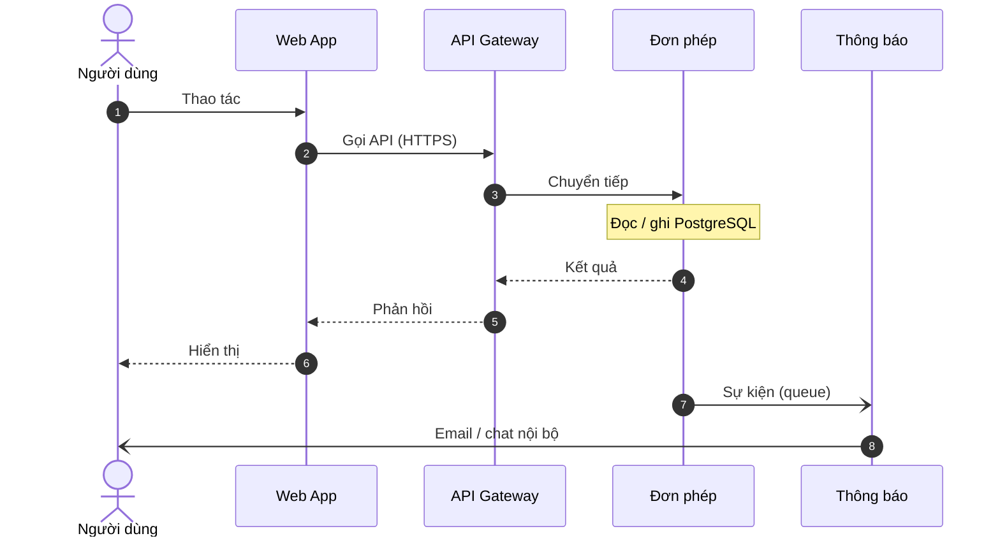
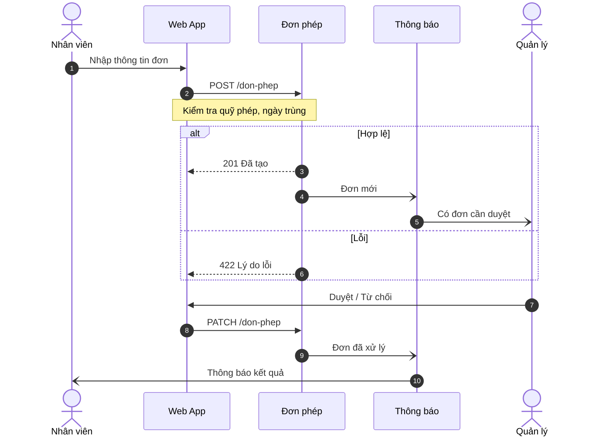
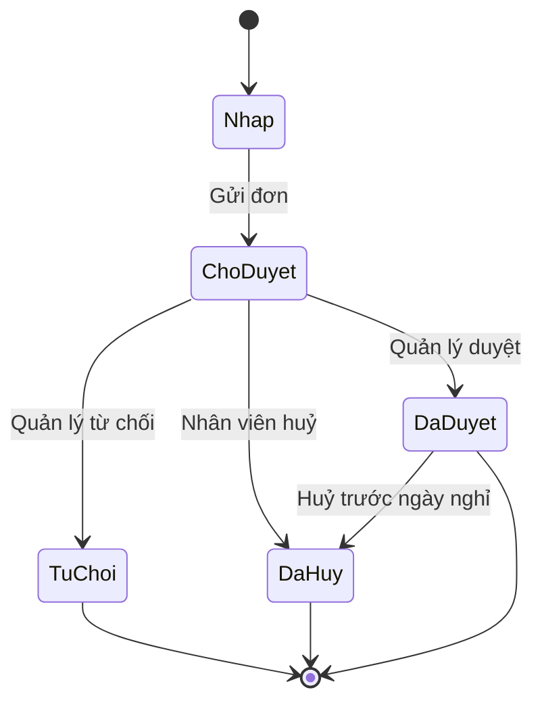
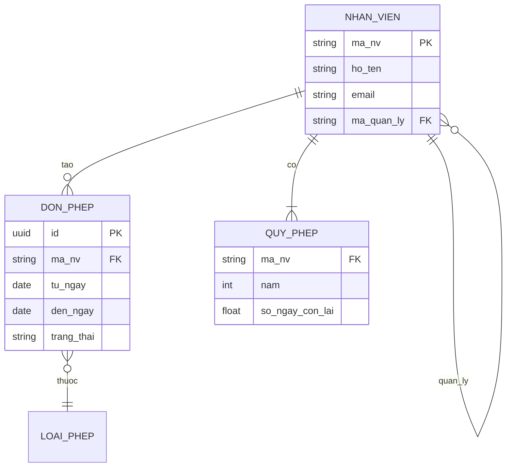
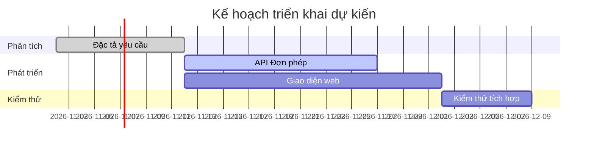

# Đặc tả yêu cầu phần mềm — Hệ thống Quản lý Đơn nghỉ phép

> Tài liệu mẫu dùng để minh hoạ cách convertSRS trình bày tiêu đề, bảng, danh sách, khối mã và các loại sơ đồ Mermaid. Nội dung nghiệp vụ là giả định.

## 1. Giới thiệu

### 1.1 Mục đích

Tài liệu mô tả các yêu cầu chức năng và phi chức năng của hệ thống **Quản lý Đơn nghỉ phép** (gọi tắt là *QLNP*), dùng làm cơ sở cho thiết kế, phát triển và kiểm thử.

### 1.2 Phạm vi

- Nhân viên tạo, sửa, huỷ đơn nghỉ phép.
- Quản lý trực tiếp duyệt hoặc từ chối đơn.
- Phòng Nhân sự theo dõi quỹ phép và xuất báo cáo.
- Ngoài phạm vi: tính lương, chấm công vân tay.

### 1.3 Thuật ngữ

| Thuật ngữ | Giải thích |
|-----------|------------|
| Đơn | Yêu cầu nghỉ phép do nhân viên tạo, gồm loại phép, thời gian và lý do |
| Quỹ phép | Số ngày phép còn lại của nhân viên trong năm |
| Người duyệt | Quản lý trực tiếp được cấu hình trong sơ đồ tổ chức |

## 2. Mô tả tổng quan

### 2.1 Kiến trúc hệ thống



### 2.2 Tác nhân

| Mã | Tác nhân | Mô tả |
|----|----------|-------|
| TN-01 | Nhân viên | Tạo và theo dõi đơn của bản thân |
| TN-02 | Quản lý | Duyệt đơn của nhân viên thuộc quyền |
| TN-03 | Nhân sự | Quản trị quỹ phép, xem báo cáo toàn công ty |

## 3. Yêu cầu chức năng

### 3.1 UC-01 Tạo đơn nghỉ phép

**Tiền điều kiện:** nhân viên đã đăng nhập, còn quỹ phép.

1. Nhân viên chọn loại phép và khoảng thời gian.
2. Hệ thống kiểm tra quỹ phép và ngày trùng.
3. Nhân viên xác nhận gửi đơn.
4. Hệ thống gửi thông báo tới người duyệt.



### 3.2 Vòng đời đơn



### 3.3 Quy tắc nghiệp vụ

- [x] BR-01: Không cho phép tạo đơn có khoảng thời gian trùng đơn đã duyệt.
- [x] BR-02: Đơn trên 5 ngày cần thêm duyệt của Nhân sự.
- [ ] BR-03: Tự động duyệt nếu quá 3 ngày làm việc không xử lý *(đang xem xét)*.

## 4. Dữ liệu



Ví dụ payload tạo đơn:

```json
{
  "loaiPhep": "PHEP_NAM",
  "tuNgay": "2026-11-03",
  "denNgay": "2026-11-05",
  "lyDo": "Việc gia đình"
}
```

## 5. Yêu cầu phi chức năng

| Mã | Nhóm | Yêu cầu |
|----|------|---------|
| NFR-01 | Bảo mật | Đăng nhập qua SSO nội bộ; phân quyền theo vai trò |
| NFR-02 | Khả dụng | Giao diện dùng được trên điện thoại từ 375px |
| NFR-03 | Nhật ký | Lưu vết mọi thao tác duyệt / từ chối kèm thời điểm và người thực hiện |

## 6. Kế hoạch triển khai


